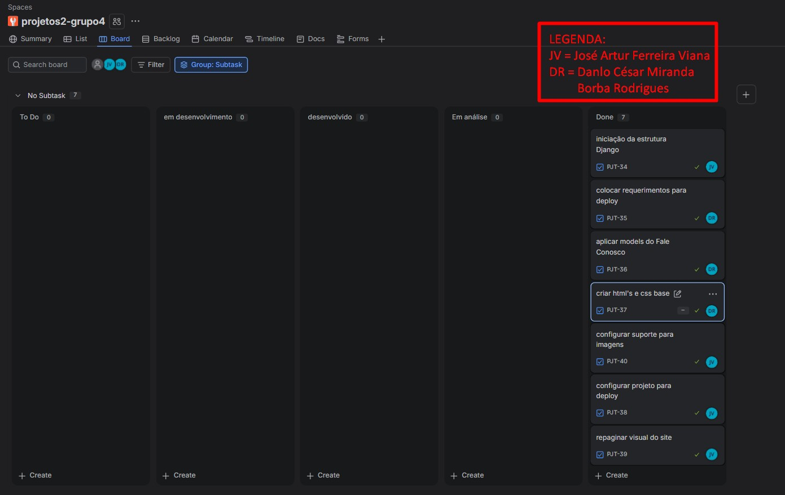
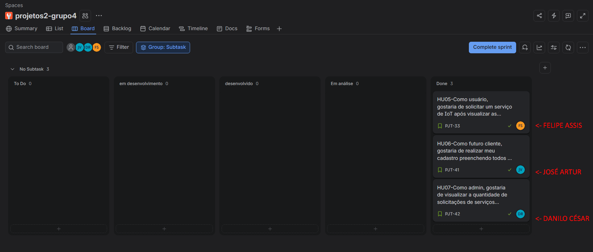
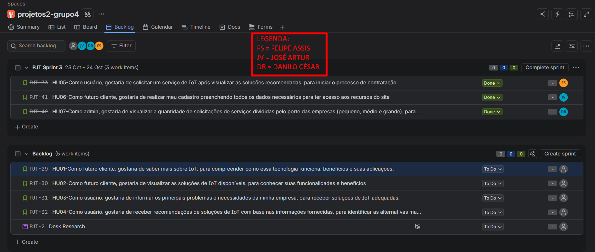

# Operos

## Descrição do Projeto

O Operos é um projeto voltando a educar empresas sobre a importância de coletar dados operacionais por meio de IoT para melhorar a gestão e a tomada de decisão.

## Tecnologias Usadas

- Python
- Django

---
---
## Entrega 01

### [Análise de competidores](entrega-01/analisedecompetidores.md)

---
---

## Entrega 02

### Quadro da Segunda Sprint

### [Screen Cast](https://youtu.be/S3bN48h3mFk)

---
---
## Entrega 03

### (placeholder historias)
1. **HU01** - Como futuro cliente, gostaria de saber mais sobre IoT, para compreender como essa tecnologia funciona, benefícios e suas aplicações.
    - **Descrição:**  O site deve apresentar uma interface organizada, intuitiva e visualmente clara. As informações, textos e elementos gráficos devem ser dispostos de maneira que facilite a compreensão do conteúdo pelo usuário. 
    - **Caso I:** futuro cliente consegue visualizar o conceito de IoT e seus impactos
        - **Dado que** o futuro cliente acessou o site
        - **Quando** ele entrar na página home e for lendo ela
        - **Então** o site deve mostrar de maneira clara sobre o conceito de IoT
            - **E** deve destacar os benefícios e importância de seu uso em diversas métricas, especialmente para a parte de coleta de dados
            - **E** deve apresentar exemplos claros com vídeos

2. **HU02** - Como futuro cliente, gostaria de visualizar as soluções de IoT disponíveis, para conhecer suas funcionalidades e benefícios.
    - **Descrição:** sistema deve apresentar as soluções de IoT disponíveis, descrevendo suas funcionalidades, aplicações e benefícios de maneira organizada e compreensível, permitindo que futuros clientes identifiquem quais alternativas podem atender às necessidades de suas empresas.
    - **Caso I:** soluções são apresentadas com sucesso
        - **Dado que** um futurro cliente acessa o site
        - **Quando** ele chega na parte de soluções existentes
        - **Então** o site deve mostrar as soluções disponíveis
            - **E** cada solução deve mostrar sua descrição de sua finalidade
            - **E** deve apresentar funcionalidades e benefícios da adoção dela para o cliente
            - **E** precisa usar uma linguagem amiga ao público geral

4. **HU03** - Como **usuário logado**, gostaria de informar os principais problemas e necessidades da minha empresa, para receber soluções de IoT adequadas.
    - **Descrição:** O sistema deve permitir que um cliente autenticado informe as características de sua empresa e suas principais necessidades operacionais, validando os dados fornecidos e registrando as informações necessárias para identificar soluções de IoT compatíveis com seu contexto empresarial. 
    - **Caso I:** O preenchimento e envio dos requisitos é feito pelo cliente com sucesso
        - **Dado que** m cliente está logado no sistema e informa suas necessidades a serem atendidas
        - **Quando** informar os dados necessários, como setor de atuação da empresa, porte e problemas a serem resolvidos, e envia todas suas respostas preenchidas corretamente
        - **Então** o sistema deve avaliar os dados informados e retornar a solução mais adequada ao cliente
            - **E** ...
    - **Caso II:** o preenchimento dos requisitos do cliente está incompleto
        - **Dado que** um cliente está logado no sistema e acessa a parte de informar suas necessidades a serem atendidas
        - **Quando** tenta enviar o formulário sem preencher um ou mais campos
        - **Então** o sistema deve impedir de que sua requisição seja enviada
            - **E** deve retornar um feedback visual de que o envio não pôde ser feito porque existe um ou mais campos vazios

6. **HU04** - Como **usuário logado**, gostaria de solicitar um serviço de IoT após visualizar as soluções recomendadas, para iniciar o processo de contratação.
    - **Descrição:** Permitir que o usuário solicite um serviço de IoT após ver as soluções recomendadas para iniciar o processo da contratação 
    - **Caso I:**  A solicitação do serviço para a empresa é feita com sucesso
        - **Dado que** o cliente está logado e visualiza detalhes de uma solução de IoT recomendada ou disponível
        - **Quando** ele selecionar a opção de solicitação de serviço, preenchendo corretamente os campos e confirmando o envio
        - **Então** o sistema deve receber os dados fornecidos
            - **E** E registrar a solicitação ligada ao cliente e à solução escolhida
            - **E** deve armazenar os dados necessários para que a equipe responsável possa prosseguir com o atendimento 
            - **E** retornar um feedback visual de que seu pedido foi registrado (tipo pop up por ex)
            - **E** informar um protocolo (<-- ns se dá p fzr mas seria daora até)

7. **HU05** - Como **futuro cliente**, gostaria de realizar meu cadastro preenchendo todos os dados necessários para ter acesso aos recursos do site
    - **Descrição:** sistema deve disponibilizar um formulário de cadastro estruturado que colete as informações essenciais do usuário, validando regras cruciais como o limite de caracteres para o nome de exibição e a verificação do formato do CPF ou CNPJ. Caso o preenchimento esteja correto, a conta deve ser criada e o usuário redirecionado; caso contrário, o sistema deve apontar os erros de validação correspondentes.
    - **Caso I:** cadastro feito com sucesso
        - **Dado que** cliente está na pagina de cadastro
        - **Quando** ele preenche todos os dados obrigatórios de modo válido e clica no botão de concluir cadastro,
        - **Então** ...
            - **E** ...
    - **Caso II:** nome de exibição excede o limite de caracteres
        - **Dado** que o usuário preencheu o formulário de cadastro,
        - **Quando** ele insere um "Nome de Exibição" com mais de 16 caracteres e tenta enviar o formulário
        - **Então** o sistema impede a conclusão do registro
            - **E** exibe uma mensagem de erro informando que o nome de exibição deve ter no máximo 16 caracteres.
    - **Caso III:** CPF ou CNPJ em formato inválido ou ausente
        - **Dado** que o usuário está preenchendo o formulário de cadastro
        - **Quando** ele deixa o campo de CPF/CNPJ em branco ou insere um formato incorreto e submete os dados
        - **Então** o sistema rejeita o envio do formulário
            - **E** destaca o campo com uma mensagem de erro indicando que o CPF/CNPJ é obrigatório ou inválido.
    - **Caso IV:** cadastro de e-mail já existente
        - **Dado** que já existe um usuário cadastrado com determinado e-mail
        - **Quando** um novo usuário tenta se registrar utilizando exatamente esses mesmo endereço
        - **Então** o processo de registro é interrompido pelo Django,
            - **E** o sistema exibe uma mensagem de erro informando que o e-mail já está em uso.

8. **HU06** - Como **admin**, gostaria de visualizar a quantidade de solicitações de serviços divididas pelo porte das empresas (pequeno, médio e grande), para identificar quais segmentos possuem maior demanda.
    - **Descrição:** O sistema deve disponibilizar aos administradores um painel de monitoramento que apresente a quantidade de solicitações de serviços de IoT agrupadas pelo porte das empresas (pequeno, médio e grande), permitindo identificar a distribuição da demanda entre os segmentos empresariais e apoiando a tomada de decisões.
    - **Caso I:** Funcionário consegue ver as solicitações com sucesso
        - **Dado que** o funcionário está logado e tem permissão para acessar o painel administrativo
        - **Quando** for acessar a parte de solicitações recebidas e houver pelo menos uma existente
        - **Então** o sistema deve mostrar os pedidos feitos pelos clientes
            - **E** identificar claramente cada categoria
            - **E** permitir que quem visualize possa entender a distribuição da demanda entre os portes
    - **Caso II:** Funcionário não consegue ver as solicitações pela ausência de pedidos
        - **Dado** que o funcionário está logado  e tem permissão para acessar o painel administrativo
        - **Quando** for acessar a parte de solicitações recebidas e não houver nenhuma
        - **Então** uma mensagem dizendo que não existem pedidos será mostrada

    

---
### (placeholder historias escolhidas)
---

### Foto Quadro da Sprint

---
### Foto Backlog da Sprint

---
### (placeholder screencast)

---
---
## Membros da Equipe

| Nome Completo | E-mail CESAR School |
|---|---|
| [Antonino Romero Bertino de Vasconcelos Neto] | [arbvn@cesar.school] |
| [Danilo César Miranda Borba Rodrigues] | [dcmbr@cesar.school] |
| [Davi da Fonte Cajueiro] | [dfc@cesar.school] |
| [Enzo Borges Barbosa de Andrade] | [ebba@cesar.school] |
| [Oto Gonçalves frias] | [ogf@cesar.school] |
| [Felipe Assis Ferreira dos Santos](Projeto 2) | [fafs@cesar.school] |
| [José Artur Ferreira Viana] | [jafv@cesar.school] |
## Membros Anteriores/Novos

| Nome Completo | E-mail CESAR School | Data |
|---|---|---|
| [Antonino Romero Bertino de Vasconcelos Neto] | [arbvn@cesar.school] | [Entrada: 20/08]  |
| [Davi da Fonte Cajueiro] | [dfc@cesar.school] | [Entrada: 20/08] |
| [Enzo Borges Barbosa de Andrade] | [ebba@cesar.school] | [Entrada: 20/08] |
| [João Guilherme Vanderley Vasconcelos] | [jgvv@cesar.school] | [Entrada: 20/08] [Saida: 31/08] |
| [Oto Gonçalves frias] | [ogf@cesar.school] | [Entrada: 31/08] |

# Uso de IA

A utilização de ferramentas de IA vem sendo usado para revisão de código e para propósitos pedagógicos. 
